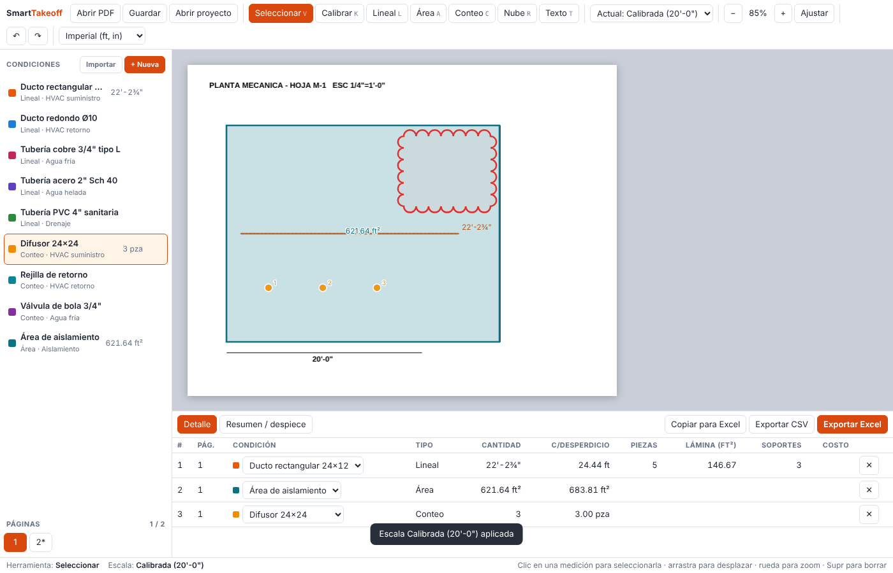

# SmartTakeoff (MVP web)

Abre `index.html` con Chrome o Edge (doble clic). No necesita internet ni instalación; los planos no salen de tu equipo.

## Flujo básico
1. **Abrir PDF** (o arrastra el plano a la ventana).
2. **Escala:** elige una del menú (1/4"=1'-0", 1:50…) o usa **Calibrar (K)** y haz clic en los extremos de una cota conocida.
3. Elige una **condición** a la izquierda (ducto, tubería, difusor…) y mide:
   - **Lineal (L):** clic por punto, doble clic o Enter para terminar. Shift = ortogonal / 45°.
   - **Área (A):** clic en cada vértice, Enter para cerrar.
   - **Conteo (C):** clic en cada elemento, Enter para cerrar el grupo.
4. **Nube (R)** y **Texto (T)** para anotaciones de revisión.
5. Pestaña **Resumen / despiece**: piezas comerciales, lámina de ducto (ft²/m²), soportes y costo.
6. **Exportar Excel** (hojas Resumen, Detalle, Condiciones, Info), **CSV** o **Copiar para Excel**.

## Condiciones
Cada condición define sistema, material, tamaño, forma de ducto (ancho×alto o diámetro), largo de pieza, separación de soportes, % de desperdicio y precio unitario.
Puedes editar la hoja *Condiciones* del Excel exportado y volver a cargarla con **Importar**.

## Atajos
V seleccionar · K calibrar · L lineal · A área · C conteo · R nube · T texto · Supr borrar · Ctrl+Z / Ctrl+Y · rueda = zoom · arrastrar o Espacio+arrastrar = desplazar · RePág/AvPág = páginas · Ctrl+S guardar proyecto.

El trabajo se guarda solo en el navegador por nombre de plano; usa **Guardar** para tener un respaldo `.takeoff.json`.
